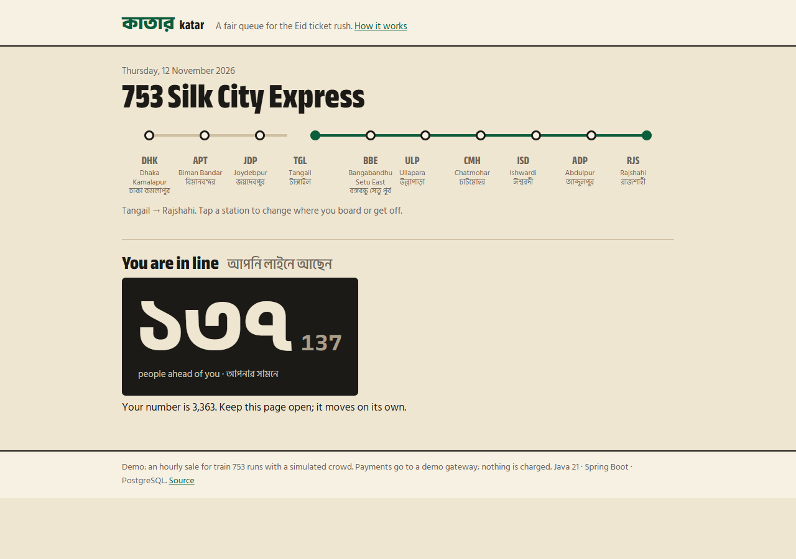
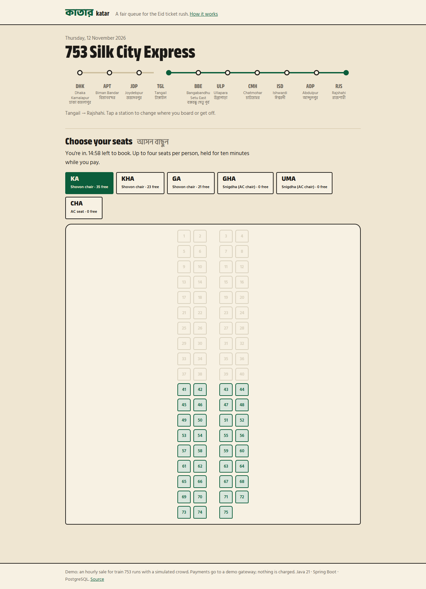
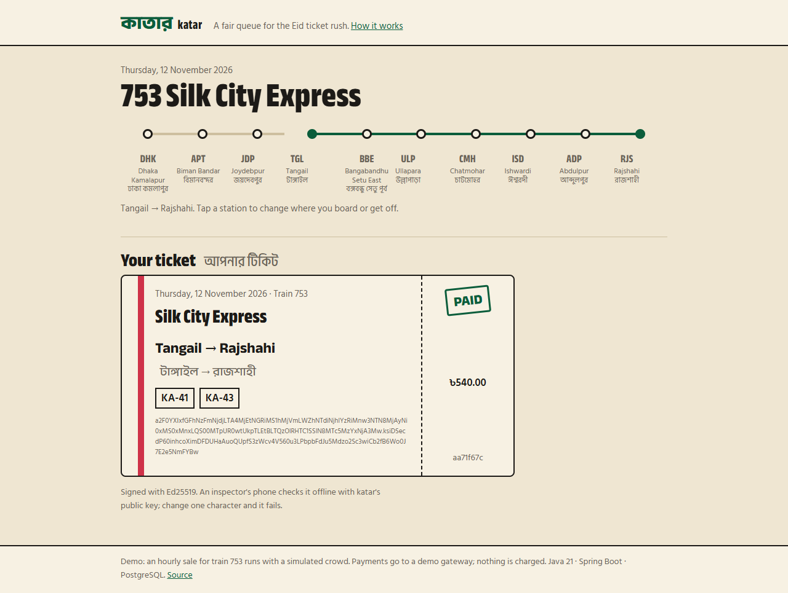

# katar

**কাতার** (katar) is Bangla for a queue, a row. It's a train-ticketing engine
for the Eid rush in Bangladesh: the morning sales open and hundreds of
thousands of people press "buy" in the same second, every year, and every
year the sites fall over.

katar is built to stay up and stay fair through that. Its two hard problems:

1. **A fair virtual waiting room**, in PostgreSQL alone. Everyone gets a place in
   line, people are let in at a controlled rate, and arriving early,
   refreshing, or opening ten tabs gains nothing.
2. **Seats sold by the segment, never twice.** A seat sold from Dhaka to Tangail
   is sold again from Tangail to Rajshahi. A thousand simultaneous requests can
   never give two people overlapping stretches of the same seat.

Java 21 (virtual threads), Spring Boot 4, PostgreSQL 18, Flyway; 35 tests that
run against a real PostgreSQL; a k6 rush test; GitHub Actions; an
amd64 + arm64 image.

| The queue | Choosing seats | The ticket |
|---|---|---|
|  |  |  |

## The seat, as a bitmask

A route is a list of stops; leg *i* runs from stop *i* to stop *i + 1*. The
Silk City Express has ten stops, so nine legs. A journey from stop *a* to stop
*b* uses legs *a* to *b − 1*: a contiguous run of bits.

```
legs        0   1   2   3   4   5   6   7   8
          DHK APT JDP TGL BBE ULP CMH ISD ADP RJS
Dhaka → Tangail      ███████████                    mask 0b000000111
Tangail → Rajshahi               ███████████████    mask 0b111111000   no overlap: both sell
Airport → Setu East      ███████████                mask 0b000001110   overlaps the first: refused
```

Each seat row stores `taken`, the legs already held or sold. Taking a seat is
**one statement**:

```sql
UPDATE seat SET taken = taken | :mask
WHERE id = :id AND (taken & :mask) = 0
```

It tests and sets in the same step. If no row was updated, someone holds an
overlapping leg. There is no "read the seat, decide, write it back", so no
concurrent request can slip between the check and the write, and no lock is
held beyond that one row for that one statement. The race tests fire 200
overlapping claims at one seat (exactly one wins), nine disjoint ones (all
nine win), and 300 buyers at a 75-seat coach (exactly 75 sold, never the same
seat twice).

## The waiting room

```
joined before opening ──► (no number yet)  ──┐  at opening: shuffled at random
joined after opening  ──► nextval(sale_N_ticket) ┘
                                   │
     place in line = ticket − admitted_upto        (O(1): no counting)
                                   │
     admitter, every second: admitted_upto += min(rate, free room)
                                   │
     ticket ≤ admitted_upto ──► claim a signed admission pass (2-minute window)
```

- **Each sale has its own sequence.** Tickets are consecutive, so your place is a subtraction, not a `count(*)` over a hundred thousand rows on every poll. Joining is one `nextval` and one insert, with no row locks.
- **Arriving early gains nothing.** People who join before opening have no number; the moment the sale opens they're shuffled at random. Nobody needs to camp on the page at 07:50.
- **One place per person.** The national ID is stored only as a keyed hash (HMAC with a server-side pepper). Joining again returns the same place, so refreshing or opening ten tabs gains nothing.
- **Capacity, not just rate.** The admitter moves the watermark by at most the sale's rate, and never further than the booking room has space for. People who are offered a turn but don't claim it within two minutes lapse, so no-shows can't block the room.
- **Joining doesn't race the shuffle.** Joins take a *shared* advisory lock on the sale; the opening shuffle takes it *exclusively*. Joiners never wait on each other, only on the shuffle's one short moment.
- **Admission passes are HMAC-signed and checked against the database,** so a person who finished or expired can't keep booking with an old token.

## Decisions worth explaining

**A hold is a TTL, and the sweeper uses `SKIP LOCKED`.** Held seats wait ten
minutes for payment. The sweeper expires due holds in batches with
`FOR UPDATE SKIP LOCKED`, so several app instances can sweep at once, and a
hold being paid for right now (its row locked) is simply left for the next
pass.

**The four-seat limit holds under parallel requests.** Counting a person's
seats and then holding another is a check-then-act race. Each person's holds
take a transaction-scoped advisory lock keyed by that person, so ten parallel
requests get exactly four seats, while different people never wait on each
other.

**Bookings are idempotent.** The client sends an `Idempotency-Key`. The same key
always returns the same booking; the same key with different seats is
refused (422) rather than silently ignored. Twelve simultaneous copies of one
request make one booking. The tests found the subtle case: a retry that waits
on the first request's row locks then finds its holds attached, and must
return *that* booking, not "hold gone".

**A payment that arrives too late is a refund, not a lost seat.** The gateway's
webhook is trusted only with a valid HMAC, compared in constant time. Paying
twice is a no-op. If the seats expired before the money arrived, the booking
is cancelled and the outcome says `REFUND`, so nobody ends up charged with no
seat.

**Tickets are signed with Ed25519, not an HMAC.** An inspector's phone holds
only the public key, so it can verify any ticket offline, and a lost phone
can't be used to forge one. Change one character and the code no longer
verifies.

**Hand-written SQL, not JPA.** The guarantees live in the statements: a
conditional bitwise update, `SKIP LOCKED`, advisory locks, `ON CONFLICT`, a
per-sale sequence. An ORM would hide exactly the parts that matter. Spring's
`JdbcClient` keeps them visible.

**Time is injected.** Every timestamp comes from one `Clock` and is passed into
SQL as a parameter, never read with `now()` in a query, so the tests move
time forward instead of sleeping.

## Numbers

**Tests:** 35, against an embedded PostgreSQL 18 (the same major version as
production; no Docker needed). They include the races above, 2,000
simultaneous joins getting tickets 1 to 2,000 with no gaps or repeats, the
shuffle, expiry, idempotent retries, refunds, forged passes and tickets, and
the whole purchase over HTTP.

**Rush test** (`loadtest/`, k6): 800 people arriving within three seconds, each
joining, waiting, holding one or two seats on a random stretch, booking and
paying. On a laptop that also runs k6 and PostgreSQL: **0 of 5,266 requests
failed**, 678 bookings paid (978 seat-journeys on a 385-seat train), 407
requests a second, and `check.sql` found **no seat sold twice and nobody over
the limit**. The first run found something real: Tomcat's default accept
backlog refused 576 of 800 simultaneous connections, now raised. Details in
[loadtest/RESULTS.md](loadtest/RESULTS.md).

## API

| | |
|---|---|
| `GET /api/sales` | upcoming sales |
| `GET /api/sales/{id}` | a sale with its route and coaches |
| `POST /api/sales/{id}/queue` | join (`{nationalId}`): a place and a queue token |
| `GET /api/sales/{id}/queue/me` | your place (`X-Queue-Token`) |
| `GET /api/sales/{id}/queue/stream?token=` | your place, pushed every second (SSE) |
| `POST /api/sales/{id}/pass` | claim your admission pass when your turn comes |
| `GET /api/sales/{id}/availability?from=&to=` | free seats per coach for your legs |
| `GET /api/sales/{id}/coaches/{code}?from=&to=` | the seat map of one coach |
| `POST /api/sales/{id}/holds` | hold a seat (`Authorization: Pass …`) |
| `DELETE /api/sales/{id}/holds/{hold}` | give it back |
| `POST /api/sales/{id}/bookings` | book held seats (`Idempotency-Key`) |
| `POST /api/payments/webhook` | the gateway's signed callback (`X-Signature`) |
| `POST /api/bookings/{id}/demo-pay` | the demo gateway |
| `GET /api/tickets/verify?code=` | check a ticket |
| `GET /api/tickets/public-key` | the Ed25519 key inspectors verify with |

Errors have one shape, `{"error": {"code", "message"}}`; clients branch on the
code. Joining, holding and booking are rate-limited per address with a token
bucket.

## Running it

```console
$ ./mvnw verify                      # 35 tests, embedded PostgreSQL 18
$ ./mvnw -DskipTests package
$ java -jar target/katar-0.0.1-SNAPSHOT.jar --katar.demo=true \
    --spring.datasource.url=jdbc:postgresql://localhost:5432/katar
```

Then open http://localhost:8080. With `--katar.demo=true`, an hourly sale opens
for the Silk City Express ten days ahead, and a simulated crowd keeps a few
hundred people in the queue. Secrets come from `KATAR_PASS_SECRET`,
`KATAR_PERSON_PEPPER`, `KATAR_PAYMENT_SECRET` and `KATAR_TICKET_PRIVATE_KEY`
(PKCS#8, base64: `openssl genpkey -algorithm ed25519 -outform DER | base64`);
the development defaults say plainly that they're not for production.

## Layout

```
src/main/java/dev/nafiz/katar/
  inventory/   Legs (the bitmask), SeatInventory (the one UPDATE), Journeys
  queue/       Sales, WaitingRoom (join, place, pass), Admitter, QueueTokens
  booking/     Holds, Bookings (idempotent), Payments (webhook), TicketSigner (Ed25519)
  web/         controllers, errors, rate limiting
  demo/        the hourly sale and its simulated crowd
  config/      properties, the signer, scheduled jobs
src/main/resources/db/migration/   the schema and a sample route (Flyway)
src/main/resources/static/         the booking page (plain HTML, CSS, JS)
loadtest/                          the k6 rush and the oversell check
```

The route and fares are a sample built on real station names; they are not
Bangladesh Railway's timetable or prices.
